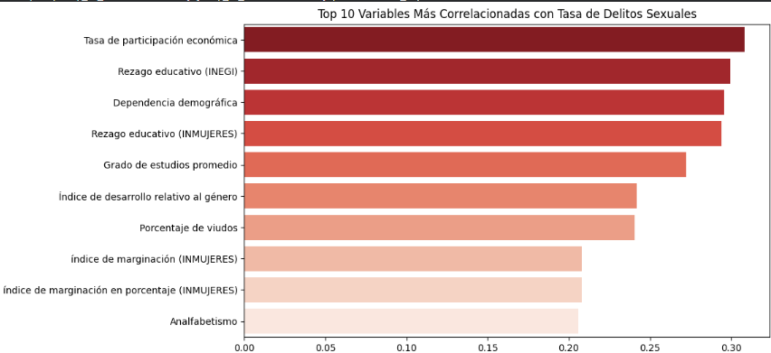

# Sexual Offense Incidence in Mexico | PCA and Regression Analysis

### Municipal Socioeconomic Indicators, Principal Component Analysis, and Statistical Modeling with Python

<div align="center">



*Exploratory analysis of municipal sexual offense incidence and socioeconomic indicators in Mexico using Python, PCA, and regression.*

</div>

**Project Type:** Academic Data Science and Statistical Research  
**Field:** Data Science | Statistical Analysis | Social Data Analytics | Machine Learning  
**Programming Language:** Python  
**Environment:** Google Colab | Jupyter Notebook  
**Study Context:** Mexican Municipal Indicators, 2011  
**Author:** Data Engineer Luis Barahona

---

## 1. Project Overview

This project explores municipal sexual offense incidence indicators in Mexico using statistical analysis, Principal Component Analysis (PCA), and multiple linear regression.

The notebook examines relationships between the reported sexual offense rate and municipal socioeconomic, demographic, educational, and public infrastructure indicators.

Its primary purpose is to understand how statistical and dimensionality reduction techniques can be applied to complex social datasets.

The analysis includes:

- Dataset exploration.
- Distribution analysis.
- Outlier detection.
- Missing-value inspection.
- Correlation analysis.
- Redundant feature identification.
- Covariance matrices.
- Eigenvalues and eigenvectors.
- Principal Component Analysis.
- Multiple linear regression.
- Regression evaluation.
- Municipal rankings.
- Socioeconomic indicator comparisons.

The project is an exploratory educational study, not a validated crime forecasting or causal inference system.

---

## 2. Research Objectives

The project aims to:

1. Explore municipal indicators related to reported sexual offenses in Mexico.
2. Understand the statistical structure of the dataset.
3. Identify variables associated with the target indicator.
4. Examine possible outliers and missing observations.
5. Calculate correlations between numerical variables.
6. Understand covariance matrices and eigenvalue decomposition.
7. Apply Principal Component Analysis.
8. Develop a multiple linear regression baseline.
9. Compare original-feature regression with PCA-based regression.
10. Evaluate model outputs using standard regression metrics.
11. Identify municipalities with high reported incidence rates.
12. Discuss the limitations of statistical analysis in sensitive social research.

---

## 3. Dataset Description

The notebook uses two external data files:

```text
indicadores.csv
Nombres.xls
```

### indicadores.csv

Contains municipal indicators used in the statistical analysis.

### Nombres.xls

Contains descriptive labels for coded variables.

The notebook uses this file to improve the interpretability of tables and visualizations.

### Target Variable

```text
T_SEX
```

This variable represents the recorded sexual offense rate in the municipal indicator dataset.

### Selected Variables

| Variable | Description |
|:---|:---|
| MUN | Municipality |
| T_SEX | Sexual offense rate |
| POB_TOT | Total population |
| SALDO_NETO_MIG | Net migration balance |
| TS_EXP_ALCOHOL | Alcohol establishments per 100,000 inhabitants |
| TS_ID | Sports infrastructure indicator |
| IM | Marginalization index |
| IM_100 | Marginalization index expressed on a percentage scale |
| ASIST_ESC_MUJ | Female school attendance |
| ASIST_ESC_HOM | Male school attendance |
| PORC_POB_INDIG | Indigenous population percentage |
| IND_FEM | Femininity index |
| T_PART_ECONOM | Economic participation rate |
| IDG | Gender-related development index |
| IMMU_REZ_EDUC | Educational disadvantage indicator |
| GRADO_PROM | Average years of schooling |
| REZ_EDUC | Educational disadvantage |
| DEP_DEM | Demographic dependency |

Additional variables describe poverty, inequality, migration, housing conditions, and other municipal characteristics.

The original source documentation should be consulted to establish exact variable definitions, denominators, geographic coverage, and reporting limitations.

---

## 4. Exploratory Data Analysis

The notebook begins by loading the dataset with Pandas.

```python
import pandas as pd
import numpy as np
import matplotlib.pyplot as plt
import seaborn as sns

df = pd.read_csv("indicadores.csv")
```

The exploratory workflow includes several analytical stages.

### Variable Distribution

Histograms are generated for numerical indicators.

These visualizations help identify:

- Asymmetric distributions.
- Concentrated observations.
- Potential extreme values.
- Differences between variable scales.

### Outlier Detection

The notebook implements an Interquartile Range (IQR) procedure.

The method evaluates numerical variables to identify observations outside an expected range.

Flagged observations require contextual interpretation.

An extreme value is not automatically a data error.

### Missing-Value Analysis

The notebook calculates the percentage of missing observations for each column.

This helps identify variables requiring further review or data quality treatment.

### Correlation Analysis

A correlation matrix is calculated using the numerical variables.

```python
numeric_df = df.select_dtypes(
    include=["float64", "int64"]
)

correlation_matrix = numeric_df.corr()
```

Correlation heatmaps are generated to visualize linear relationships between indicators.

---

## 5. Redundant Variable Detection

The notebook examines highly correlated numerical variables.

A correlation threshold is configured as:

```python
correlation_threshold = 0.9
```

Pairs of variables exceeding this threshold are flagged for further examination.

### Purpose

Highly correlated predictors may introduce redundancy or unstable regression coefficients.

However, correlation alone is not sufficient to establish that a variable should be removed.

Decisions about feature selection should consider statistical and substantive relevance.

---

## 6. Principal Component Analysis

Principal Component Analysis is a linear dimensionality reduction technique.

It transforms the original numerical variables into a new set of orthogonal components.

Each principal component represents a direction of variation in the data.

### Mathematical Procedure

The notebook explores:

1. Mean calculation.
2. Data centering.
3. Covariance matrix construction.
4. Eigenvalue decomposition.
5. Eigenvector analysis.
6. Explained variance.
7. Projection matrices.
8. Dimensionality reduction.

### Covariance Matrix

For a centered numerical dataset:

```python
X_centered = X - np.mean(X, axis=0)

C = np.cov(
    X_centered,
    rowvar=False
)
```

### Eigenvalue Decomposition

```python
eigenvalues, eigenvectors = np.linalg.eig(C)
```

Eigenvalues describe variance associated with the corresponding component directions.

### Principal Component Projection

```python
X_projected = X_centered @ eigenvectors
```

The notebook includes multiple mathematical exercises illustrating these operations.

Some introductory examples use small synthetic matrices to explain PCA independently of the municipal dataset.

---

## 7. PCA with Scikit-learn

The notebook also introduces PCA using Scikit-learn.

```python
from sklearn.decomposition import PCA

pca = PCA(n_components=2)
X_reduced = pca.fit_transform(X)
```

This demonstrates how a dataset can be represented using fewer numerical dimensions.

### Explained Variance

The notebook examines the percentage of total variance explained by each component.

It also explores selecting enough components to retain 95% of the dataset variance.

### Interpretation

A high explained-variance percentage means that a set of components preserves much of the input data's variation.

It does not necessarily mean that the components preserve all information relevant to predicting a particular outcome.

---

## 8. Multiple Linear Regression

The notebook builds a multiple linear regression model using numerical municipal indicators.

### Main Objective

Estimate the target variable:

```text
T_SEX
```

from the selected predictors.

### Model Structure

```text
T_SEX = β0 + β1X1 + β2X2 + ... + βnXn + ε
```

Where:

- β0 is the intercept.
- β1 through βn are regression coefficients.
- X1 through Xn are explanatory variables.
- ε is the residual error.

### Training and Testing

The notebook uses an 80/20 train-test split:

```python
X_train, X_test, y_train, y_test = (
    train_test_split(
        X,
        y,
        test_size=0.2,
        random_state=42
    )
)
```

The baseline model standardizes predictors using StandardScaler.

### Model Training

```python
from sklearn.linear_model import LinearRegression

model = LinearRegression()
model.fit(X_train_scaled, y_train)
```

The fitted model generates predictions for the test observations.

---

## 9. Experimental Regression Results

The notebook records the following results.

### Original-Feature Linear Regression

| Metric | Saved Value |
|:---|---:|
| Mean Squared Error | 84.6396 |
| Root Mean Squared Error | 9.2000 |
| Mean Absolute Error | 6.6665 |
| R² | 0.0251 |

### Interpretation

The recorded R² indicates that this fitted model explains only a small proportion of the variation in the held-out target observations.

The results do not demonstrate strong predictive performance.

Further modeling and validation would be required.

---

## 10. PCA-Based Regression Experiment

The notebook subsequently applies StandardScaler and PCA to the numerical dataset.

The selected principal components are used as inputs to another Linear Regression model.

### Saved PCA Regression Results

| Metric | Saved Value |
|:---|---:|
| Mean Squared Error | 0.3742 |
| Root Mean Squared Error | 0.6117 |
| Mean Absolute Error | 0.5021 |
| R² | 0.9957 |

The saved outputs show much lower errors than the original-feature regression.

### Critical Methodological Limitation

These numbers must not be interpreted as evidence of successful predictive performance.

The PCA experiment contains two major forms of data leakage.

**1. Target Leakage**

The feature matrix is created using all numerical columns:

```python
X = df.select_dtypes(
    include=["float64", "int64"]
)
```

This includes `T_SEX`, the same variable being predicted.

Consequently, the PCA components contain information derived directly from the target.

**2. Test-Data Leakage**

StandardScaler and PCA are fitted using the entire dataset before the train-test split.

Therefore, information from the eventual test observations influences the feature transformation.

### Consequence

The reported PCA R² of 0.9957 is not a valid estimate of out-of-sample predictive performance.

A corrected experiment must exclude the target from the feature matrix and fit all preprocessing operations using training data only.

---

## 11. Corrected Modeling Approach

A more reliable workflow should separate the target from the predictors before preprocessing.

### Recommended Python Example

```python
from sklearn.model_selection import train_test_split
from sklearn.pipeline import Pipeline
from sklearn.preprocessing import StandardScaler
from sklearn.decomposition import PCA
from sklearn.linear_model import LinearRegression
from sklearn.metrics import (
    mean_absolute_error,
    mean_squared_error,
    r2_score
)
import numpy as np

# Separate predictors from the target
y = df["T_SEX"]

X = df.select_dtypes(
    include=[np.number]
).drop(columns=["T_SEX"])

# Remove or impute missing observations as appropriate
valid = X.notna().all(axis=1) & y.notna()

X = X.loc[valid]
y = y.loc[valid]

# Chronologically independent observations are not
# applicable to this single-year cross-sectional example.
X_train, X_test, y_train, y_test = train_test_split(
    X,
    y,
    test_size=0.2,
    random_state=42
)

# Baseline regression
baseline = Pipeline([
    ("scaler", StandardScaler()),
    ("regression", LinearRegression())
])

# PCA regression
pca_model = Pipeline([
    ("scaler", StandardScaler()),
    ("pca", PCA(n_components=0.95)),
    ("regression", LinearRegression())
])

for name, model in [
    ("Baseline", baseline),
    ("PCA Regression", pca_model)
]:
    model.fit(X_train, y_train)

    predictions = model.predict(X_test)

    print(name)
    print("MAE:", mean_absolute_error(
        y_test, predictions
    ))
    print("RMSE:", np.sqrt(
        mean_squared_error(y_test, predictions)
    ))
    print("R2:", r2_score(
        y_test, predictions
    ))
```

This example demonstrates how to avoid the main preprocessing leakage issues.

It is a recommended correction and does not reproduce or validate the notebook's previously saved results.

Additional attention should be given to geographic dependence, feature selection, duplicate observations, and the reliability of the original municipal indicators.

---

## 12. Regression Model Visualization

The notebook generates several visualizations comparing the two fitted models.

### Actual vs. Predicted

Scatter plots compare observed values with model predictions.

### Residual Analysis

Residual charts help identify patterns in prediction errors.

### Residual Histograms

Histograms visualize the distribution of prediction errors.

### Metric Comparison

Bar charts compare recorded:

- MSE
- R²

### Explained Variance

The notebook also calculates explained-variance scores.

These visualizations demonstrate regression evaluation techniques.

However, the PCA-related charts inherit the data leakage limitations of that experiment.

---

## 13. Municipal Sexual Offense Incidence Ranking

The notebook identifies municipalities with the highest values of the recorded `T_SEX` indicator.

### Municipalities Appearing in the Saved Top-Ten Output

The saved table includes:

- Teapa
- Solidaridad
- Toluca
- Mérida
- Centro
- Pachuca de Soto
- Cuernavaca
- San Juan Bautista Tuxtepec

The ranking is based on the available municipal indicator dataset.

The notebook should not be interpreted as a current national ranking.

### Important Interpretation

Reported incidence can be affected by:

- Differences in reporting practices.
- Underreporting.
- Variable definitions.
- Administrative coverage.
- Population denominators.
- Availability of institutional records.

A higher reported rate does not necessarily establish a higher underlying prevalence of sexual violence.

---

## 14. Socioeconomic Correlation Analysis

The final analysis identifies variables with relatively strong absolute correlations with `T_SEX`.

### Selected Saved Correlations

| Indicator | Absolute Correlation |
|:---|---:|
| Economic participation rate | 0.3085 |
| Educational disadvantage (INEGI) | 0.2994 |
| Demographic dependency | 0.2959 |
| Educational disadvantage (INMUJERES) | 0.2941 |
| Average years of schooling | 0.2724 |

### Interpretation

The notebook calculates absolute correlation coefficients.

These values describe the strength of linear associations, regardless of whether their original signs are positive or negative.

They do not establish causality.

The results should not be used to attribute sexual violence to demographic groups or socioeconomic conditions without stronger methodological evidence.

---

## 15. Technologies Used

| Technology | Purpose |
|:---|:---|
| Python | Programming language |
| Pandas | Data processing |
| NumPy | Linear algebra and numerical calculations |
| Matplotlib | Statistical visualization |
| Seaborn | Exploratory visualization |
| Scikit-learn | PCA, scaling, regression, and metrics |
| StandardScaler | Feature standardization |
| LinearRegression | Statistical prediction |
| PCA | Dimensionality reduction |
| Google Colab | Cloud execution |
| Jupyter Notebook | Interactive research environment |

---

## 16. How to Run

### Google Colab

[Open the Original Notebook](https://colab.research.google.com/drive/1M85nlyna0KCdLPoAwe3hD6gsCdBHJ2jy)

### Required Files

```text
indicadores.csv
Nombres.xls
```

Both files must be available in the notebook's working directory.

### Install Dependencies

```bash
pip install pandas numpy matplotlib seaborn scikit-learn xlrd openpyxl notebook
```

### Execution Instructions

1. Open the notebook in Google Colab.
2. Upload the required files.
3. Import the Python libraries.
4. Explore the dataset.
5. Generate histograms and correlation plots.
6. Review outlier detection results.
7. Examine covariance matrices and eigenvectors.
8. Run the PCA examples.
9. Execute the baseline regression experiment.
10. Review the historical saved PCA experiment.
11. Apply a corrected regression pipeline before interpreting model comparisons.
12. Examine the municipal ranking.
13. Review socioeconomic correlations.

### Notebook Execution Considerations

Several cells reuse variables such as `X`, `C`, `df`, and `pca`.

Some mathematical PCA examples operate on small synthetic matrices rather than the full municipal dataset.

As a result, sequential execution may require reorganizing or resetting variable definitions.

---

## 17. Research Limitations

### Historical Data

The project uses a dataset associated with 2011 municipal indicators.

It does not describe current sexual offense incidence.

### Unverified Source Scope

The notebook does not fully document the provenance, geographic coverage, or reporting methodology of the source dataset.

### Ecological Data

The analysis uses municipal indicators rather than individual-level observations.

Associations observed at the municipal level cannot automatically be generalized to individuals.

### Underreporting

Recorded sexual offense rates may differ from actual incidence.

### Correlation vs. Causation

Correlation coefficients cannot identify causal factors without an appropriate research design.

### Target Leakage

The saved PCA regression includes the target variable among its inputs.

### Preprocessing Leakage

The PCA transformation is fitted before the train-test split.

### Statistical Generalization

The saved performance results are not sufficient to establish reliable predictive ability.

### Reproducibility

Some cells reuse variables and mix synthetic PCA demonstrations with dataset-specific experiments.

### Ethical Interpretation

Findings about sensitive social issues must be communicated carefully to avoid unsupported conclusions about communities or demographic groups.

---

## 18. Future Improvements

Potential developments include:

- Documenting official dataset provenance.
- Validating the variable dictionary.
- Preserving geographic identifiers.
- Correcting target leakage.
- Implementing Scikit-learn pipelines.
- Comparing multiple regression approaches.
- Adding cross-validation.
- Evaluating spatial dependence.
- Including population and reporting-rate considerations.
- Comparing different historical years.
- Adding geographic visualizations.
- Evaluating model uncertainty.
- Improving feature interpretation.
- Building reproducible statistical reports.

---

## 19. Practical Applications

The techniques explored in this notebook may support:

- Exploratory social data analysis.
- Public policy research.
- Statistical modeling education.
- Municipal indicator analysis.
- Dimensionality reduction.
- Data quality assessment.
- Regression diagnostics.
- Responsible social data research.

The existing results should not be used to make operational public safety decisions.

---

## 20. Conclusion

This project examines municipal sexual offense incidence indicators in Mexico using Python, Principal Component Analysis, and multiple linear regression.

The notebook demonstrates exploratory data analysis, correlation assessment, outlier detection, covariance calculations, PCA, and regression evaluation.

The original-feature regression reports an R² of approximately 0.025.

Although the saved PCA regression reports an R² of approximately 0.996, that result is affected by target and preprocessing leakage and cannot establish predictive superiority.

The municipal indicator analysis also identifies moderate statistical associations with socioeconomic and educational variables.

These associations do not demonstrate causal relationships.

The notebook provides an educational foundation for further work in statistical analysis, dimensionality reduction, ethical data interpretation, and reproducible social research.

---

## 21. Project Resources

### Google Colab Notebook

[Open the Original PCA and Regression Notebook](https://colab.research.google.com/drive/1M85nlyna0KCdLPoAwe3hD6gsCdBHJ2jy)

### Scikit-learn

[Scikit-learn — Machine Learning in Python](https://scikit-learn.org/stable/)

### Pandas

[Pandas Documentation](https://pandas.pydata.org/docs/)

### INEGI

[Instituto Nacional de Estadística y Geografía](https://www.inegi.org.mx/)

This external resource provides general statistical context. It should not be interpreted as confirmation of the origin of the specific CSV file without additional source documentation.

---

## Author

**Data Engineer Luis Barahona**

Mexican Data Engineer and 2026 graduate of Universidad del Caribe, interested in Data Engineering, Data Science, Machine Learning, Statistical Modeling, and responsible technology applications.

---

## Contact

| Platform | Contact |
|:---|:---|
| Email | [190300395@ucaribe.edu.mx](mailto:190300395@ucaribe.edu.mx) |
| GitHub | [github.com/LuisBarahonaMX](https://github.com/LuisBarahonaMX) |
| LinkedIn | [linkedin.com/in/luis-barahona-mx](https://www.linkedin.com/in/luis-barahona-mx/) |
| Instagram | [@luisbarahonamx](https://www.instagram.com/luisbarahonamx/) |
| X | [@luisbarahonaMX](https://x.com/luisbarahonaMX) |
| Website | [SIKO AI Platform](https://sikoai.web.app/) |
